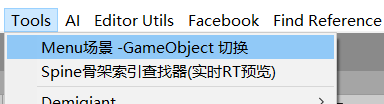

# UnityGmTemplatesMaybeSpine

A main GM template.

## Install with Unity Package Manager

In Unity, open **Window > Package Manager**, click **+**, and select **Add package from git URL...**. Enter:

```text
https://github.com/avi6111/UnityGmTemplatesMaybeSpine.git
```

# 功能

Features



0.原来的 Spine 皮肤索引浏览器

Spine Index （Skin) Viewer

1.添加动画Animation 偏移“归零”工具（需要加父节点当做 Rig)

Add Animation Offset Reset 0 zero Tools (origin GameObject may need rig a parent gameObject)

2.添加换装系统(第一期只有换贴图(Spine))

Add Change Spine Texture Directly


3.额外做了一个，UI切换的调试工具（慎用）会打开关闭window自动切换，仅适合个人向快速开发和调试；

## Editor 目录结构

```text
Assets/
└── Editor/
    ├── SpineIndexWindow.cs
    ├── SwitchAnimationZeroFrameWindow.cs
    ├── SwitchGameObjectUIWindow.cs
    └── DebugAnimationRelativeWindow.cs
```

- `SpineIndexWindow.cs`：扫描并缓存项目中的 `_SkeletonData` 资源，支持按名称查找、实时预览骨架、切换 Skin 和动画，以及调整预览镜头偏移。
- `SwitchAnimationZeroFrameWindow.cs`：动画偏移归零工具入口；提供 Tools 菜单和引导按钮，可打开 GameObject 菜单中的 `DebugAnimationRelativeWindow`。
- `SwitchGameObjectUIWindow.cs`：在场景中选择两个 GameObject 并切换启用状态，保存对象引用和切换状态以便恢复。

后续新增 Editor 工具时，可在目录树中补充对应路径，并为文件添加简要用途说明。
